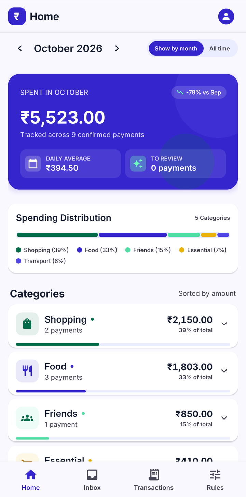
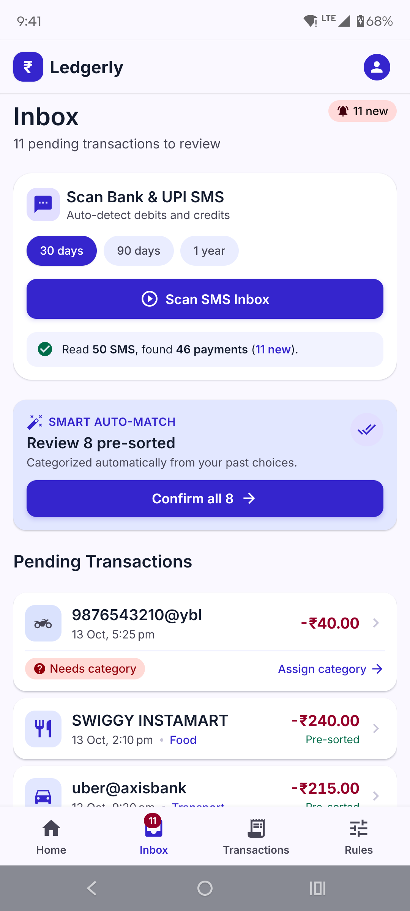
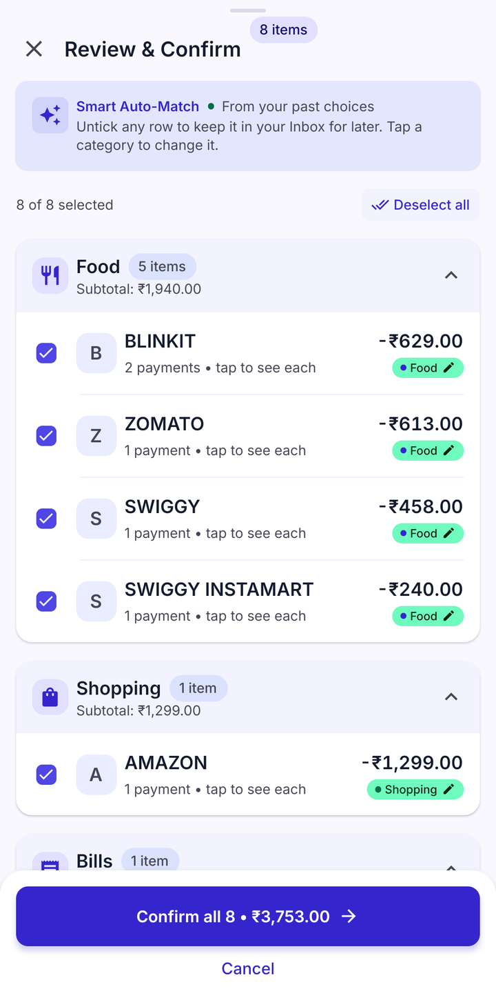
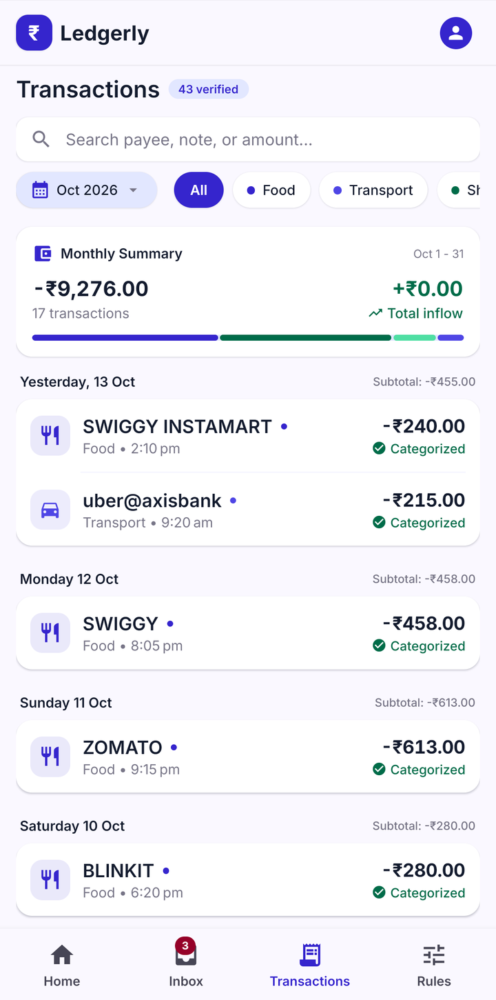
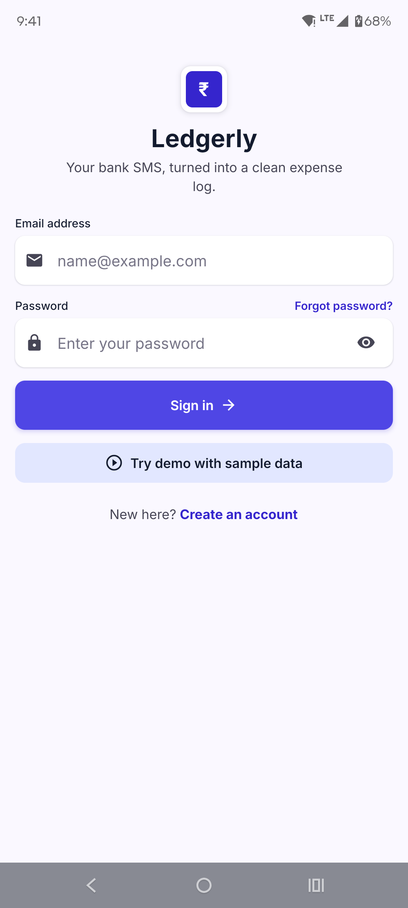
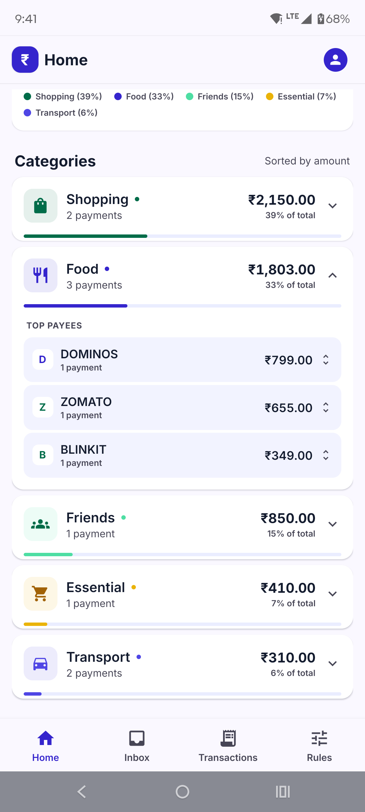
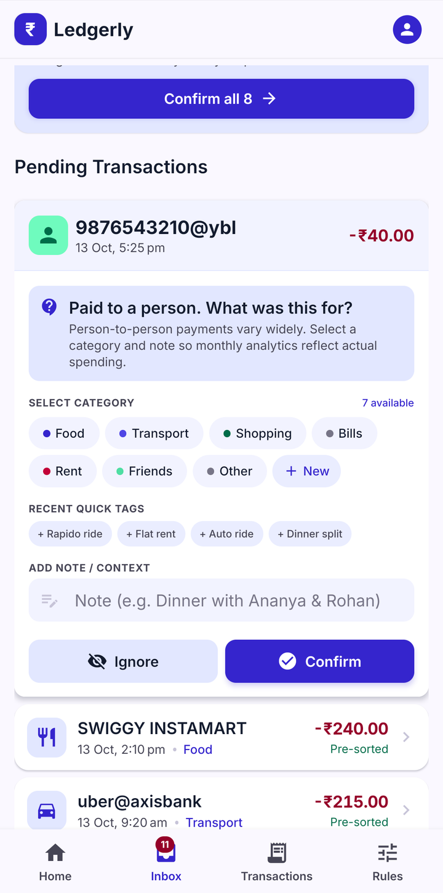
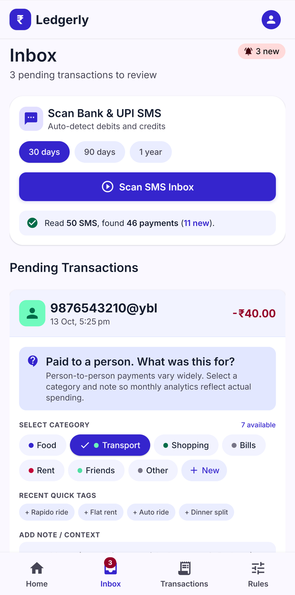
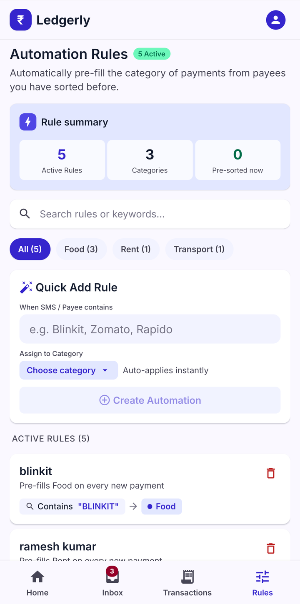
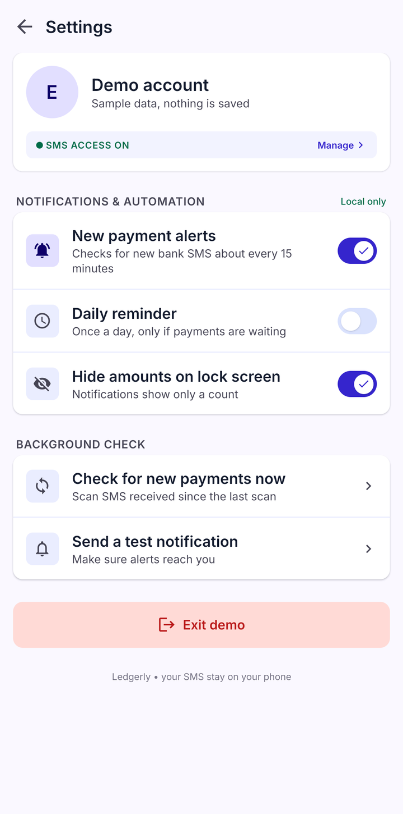

# Ledgerly

[](https://github.com/Viratgupta13/ledgerly/actions/workflows/ci.yml)


**Your bank SMS, turned into a clean expense log.**

🌐 **[Live site](https://ledgerly-virat12.vercel.app)** · ⬇ **[Download the APK](https://github.com/Viratgupta13/ledgerly/releases/latest)**

Ledgerly is an Android app that reads bank and UPI SMS **on the phone**, turns each one into a transaction, pre-sorts it into the category you have used for that payee before, and asks you to review it once. It is built for how people in India actually pay: UPI to shops, UPI to *people* (auto drivers, landlords), ₹ amounts with lakh grouping.

> **Privacy:** SMS are parsed on the device. Only the extracted amount, payee, date, category and note are saved to your account. The SMS text is never uploaded.

<p align="center">
  
  
  
  
</p>

## Try it

▶ **Watch the 60-second demo:** [`ledgerly-demo.mp4`](https://github.com/Viratgupta13/ledgerly/releases/latest) (attached to the latest release).

1. Download the APK from the [Releases](../../releases) page and install it (allow "unknown apps"; Play Protect may warn because it is not from the Play Store).
2. Tap **Try demo with sample data** on the sign-in screen. No account or SMS access is needed.
3. In the Inbox press **Scan SMS Inbox**: ~50 fake bank SMS (including OTPs, promos and a failed payment) run through the real parser. Open **Review & confirm**.

To use it for real, create an account (an email code verifies it) and allow SMS access.

## Screens

| | | |
|---|---|---|
|  |  |  |
| Sign in / demo | Home: category → payee → payments | A payment to a person asks "what was this for?" |
|  |  |  |
| Inbox after confirming a batch | Rules | Settings |

## What it does

- **SMS parser** (pure TypeScript, no UI dependencies, unit tested): separates real payments from OTPs, promos, recharge offers, failed or pending payments and bill reminders, then extracts amount, debit/credit, payee, bank reference and time.
- **Review-first workflow**: new payments land as *pending*. Debits arrive pre-categorised when the payee is known (your own rule, your past choices, or a well-known brand). One *Review & Confirm* screen lets you fix anything and confirm a batch.
- **Payments to people**: asks what it was for and groups by your note ("Rapido ride") with the drivers' names underneath.
- **Home**: monthly spend, change vs last month, daily average, category split, drill-down to single payments.
- **Transactions**: search, month and category filters, day groups with subtotals, edit or move a payment back to the Inbox.
- **Rules and categories**: "always put this payee in this category", plus your own categories.
- **Notifications**: a background check about every 15 minutes, one batched alert, optional daily reminder, lock-screen details hidden by default.
- **Accounts**: email + password, one-time email code to verify sign-up, password reset by code.

## How it works

```
Android inbox ──► classifier ──► field extractors ──► ParsedTxn (Zod-validated)
 (READ_SMS)       OTP / promo /     amount, payee,         │
                  failed / due       bank ref, time        ▼
                  are rejected                     pre-fill category
                                              rule > learned history > known brand
                                                           │
                                                           ▼
                                   pending in Supabase ──► Review & Confirm ──► confirmed
                                   (unique user_id + bank_ref,    (batch, optimistic update)
                                    so re-scans never duplicate)
```

## Engineering highlights

- **Parser as a pure module.** `src/parser` has no React or native imports; it is covered by fixtures for HDFC/SBI/ICICI/Axis formats, card spends, NEFT and UPI credits, plus negative cases (OTP, promo, failed, reminder, "Credit Card" is not a credit).
- **Idempotent imports.** `unique (user_id, bank_ref)` plus a deterministic fallback key for SMS without a reference, so scanning a year of SMS twice creates no duplicates.
- **Row Level Security** on every table (`auth.uid() = user_id`); the app only ever holds the publishable key.
- **Learning without ML.** A payee's category is predicted from what the user confirmed before (most used, ties to the most recent), with explicit rules overriding it. Everything stays pending, so the user always gets one look.
- **Optimistic UI.** Reviews and batch confirms update the list immediately and roll back with an alert if the write fails.
- **Privacy-aware notifications.** The message builder is a pure function; with "hide amounts" on, the lock screen only shows a count.
- **A demo backend that is not a mock of the parser.** "Try demo" swaps only the data layer for an in-memory store and feeds fake SMS through the same parser and pre-fill logic as production.
- **Unmaintained dependency fixed, not avoided.** `react-native-get-sms-android` (last release 2022) failed on Gradle 9; a `patch-package` patch fixes its build files, and the build was verified on a device.
- **Design system from tokens.** The UI follows an exported Stitch design (colour tokens, type scale, radii) wired into Tailwind, with a native `PagerView` for finger-following tab swipes.

## Tech stack

| Area | Choice |
|---|---|
| App | Expo SDK 57, React Native 0.86 (New Architecture), TypeScript (strict) |
| Navigation | Expo Router, `react-native-pager-view` |
| Styling | NativeWind (Tailwind) with the design's colour tokens, Inter |
| State | TanStack Query (server), Zustand (UI) |
| Validation | Zod |
| Backend | Supabase (Auth, Postgres, Row Level Security) |
| SMS access | `react-native-get-sms-android` (patched) |
| Tests / CI | Jest (94 tests), GitHub Actions (typecheck + tests) |

## Project structure

```
app/                  Expo Router routes (auth, tabs shell, settings, SMS permission)
src/
  parser/             SMS classifier and field extractors + tests
  screens/            Home, Inbox, Transactions, Rules
  components/         Payment card, Review & Confirm modal
  navigation/         TabsShell (pager + bottom bar)
  data/               Supabase queries, hooks, pure row/batch builders + tests
  demo/               Fake inbox and the in-memory backend used by "Try demo"
  reports/            Monthly breakdown (category → payee → payments) + tests
  notifications/      Message builder, settings, helpers + tests
  background/         Periodic "check for new payments" task
  sms/                Inbox reader and scan/import
  ui/                 Design tokens, shared components
supabase/migrations/  SQL schema, in order
patches/              patch-package fix for the SMS library
docs/                 Setup guides, screenshots, design export
```

## Run it yourself

### Prerequisites
Node 20+, JDK **17**, the Android SDK, an Android phone with USB debugging (or an emulator), and a Supabase project.

### 1. Install
```bash
npm install        # also applies patches/ via patch-package
```

### 2. Configure Supabase
1. Create a project; copy the **Project URL** and the **publishable (anon) key**.
2. Copy `.env.example` to `.env.local` and fill both values. Never put the `service_role` key in the app.
3. In the SQL editor, run in order: `supabase/migrations/0001_init.sql`, `0002_note_and_payee.sql`, `0003_categories.sql`.
4. Email codes: follow [`docs/email-otp-setup.md`](docs/email-otp-setup.md).

### 3. Run on a device
```bash
export JAVA_HOME=$(/usr/libexec/java_home -v 17)
npx expo run:android
```
Afterwards `npx expo start --dev-client` is enough for JS changes. If the phone cannot reach Metro: `adb reverse tcp:8081 tcp:8081`.

### Tests
```bash
npm test
npm run typecheck
```

### Build a standalone APK
```bash
npx expo prebuild --platform android
cd android && ./gradlew :app:assembleRelease
```
Bump `version` and `android.versionCode` in `app.json` for each release. The release APK is signed with the debug key: fine for testers, not for the Play Store.

## Limitations and next steps

- Android only (SMS access is not possible on iOS).
- Parser coverage grows with real-world formats; unknown formats are skipped rather than guessed.
- Email codes go through a Gmail SMTP account (about 500/day); move to a domain and a transactional email service for real traffic.
- Play Store release needs its own signing key, a privacy policy and Google's SMS-permission declaration.
- Ideas: CSV export, crash reporting, in-app feedback.

## License

© 2026 Virat Gupta. **All rights reserved.** The code is public for viewing and evaluation only. Copying, modifying or reusing it (including the design and the Ledgerly name) needs written permission. See [LICENSE](LICENSE).
